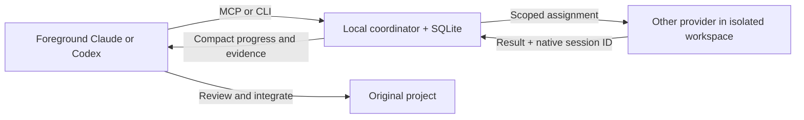

# Claude Codex Connector

**Let Claude and Codex delegate work to each other through local tools.**

A local MCP server and CLI for focused cross-provider assignments, persistent sessions, isolated editing workspaces, and reviewed integration. Either agent can manage. Communication uses APIs and a private Unix socket—no screenshots or UI automation.

[](https://github.com/tejask-dev/claude-codex-connector/actions/workflows/ci.yml)
[](LICENSE)

**Status: early preview, macOS only.** This is an independent project, not an OpenAI or Anthropic product. Its source is MIT licensed; provider SDKs, models, and services have their own terms.

## What it does

- Delegate implementation, testing, research, or review to the other provider.
- Resume the same worker with a focused follow-up instead of copying transcripts.
- Select supported models and reasoning settings between turns.
- Read progress with cursors, cancel work, or explicitly transfer management.
- Discover local skill and agent-profile instructions from both ecosystems.
- Preserve dirty source checkouts with isolated snapshots and drift-checked integration.
- Keep a local task ledger, verification evidence, and provider-reported usage.

It cannot take over every running agent, read arbitrary Desktop/cloud chats, grant unavailable plugins, or force an unrelated chat to collaborate. Automatic routing is instruction-driven. Model inference still leaves your machine and consumes provider usage.

## Authentication and cost

**Claude workers require an Anthropic API key and can incur API charges.** This public edition does not offer Claude subscription OAuth, extract login credentials, or silently fall back to another billing method. Anthropic's [Agent SDK guidance](https://code.claude.com/docs/en/agent-sdk/overview) requires API authentication for third-party products unless otherwise approved. Your foreground Claude client has its own separate account/access requirements.

Codex workers use the official local Codex CLI/app-server and its configured authentication. Provider eligibility, limits, and terms still apply. There is no shared account, proxy, telemetry, or hosted coordinator. Set spending limits with your provider; the bridge watchdog limits runtime, not dollars.

## Quick start

You need **macOS**, **Node.js 24**, npm, Git (Xcode Command Line Tools), and an installed, authenticated [Codex CLI](https://developers.openai.com/codex/cli/). Install Claude Code only if you want it as a foreground MCP client; the Claude Agent SDK supplies the worker runtime. Do not skip npm optional dependencies.

```sh
git clone https://github.com/tejask-dev/claude-codex-connector.git
cd claude-codex-connector
npm ci
npm test

# Select the existing directory containing projects you want workers to access.
mkdir -p "$HOME/Developer"
node dist/src/cli.js configure --root "$HOME/Developer"

# Hidden terminal prompt; no key is placed in shell history or MCP settings.
node dist/src/cli.js auth claude

# Register MCP with Codex and Claude Code; retain their normal approval policies.
npm run install:local
```

If Codex is not on PATH, append `--codex /absolute/path/to/codex` to configure. Add `~/.local/bin` to your PATH to use the installed `agent-team` command. Keep this checkout and its Node runtime in place. Restart/reload foreground clients after registration.

Ask either client:

> Use the local agent-team bridge. Review this project, delegate one focused read-only review to the other provider, then report the findings and verification evidence.

Start with a disposable project. `agent-team doctor` checks runtime configuration without inference. [Installation and troubleshooting](docs/INSTALLATION.md) covers custom roots, Desktop, upgrades, and uninstall.

### Optional automatic teamwork guidance

```sh
npm run install:local -- --teamwork
```

This adds marked guidance to `AGENTS.md` and `CLAUDE.md` in the configured roots, plus a root-scoped block in Codex's global instructions. It preserves unrelated text and does not add Stop hooks. Ordinary installation does not edit those instruction files. Trivial tasks should bypass peer calls.

### Claude Desktop

```sh
npm run pack:desktop
```

In Desktop, open **Settings → Extensions → Advanced settings → Install extension** and choose `build/agent-team-bridge.mcpb`. The generated package uses your local Node and checkout paths. Install/enable it, then restart Desktop if needed. Ask explicitly to use **Local Claude–Codex Team**. Build your own package: do not share one generated on another machine.

## How a task flows



The manager calls `team_start`, searches selected capabilities, delegates, reads results, reviews changes, integrates completed edits, verifies locally, then calls `team_finish`. Editing workers never merge themselves. Read-only workers do not receive an edit grant.

| Tool | Purpose |
| --- | --- |
| `team_start` | Create a bounded task and manager lease |
| `team_delegate`, `team_send` | Start or continue a peer assignment |
| `team_read`, `team_status` | Bounded progress, results, and task state |
| `team_control` | Cancel, change model, integrate, recover, or hand off |
| `team_models` | Discover provider-supported choices |
| `team_catalog`, `team_capability` | Find and read selected local skill/profile instructions |
| `team_sessions`, `team_session_read` | Read bounded supported local session history |
| `team_finish` | Record peer contribution and verification |

[Tool reference](docs/TOOLS.md) · [Copyable prompts](examples/TEAM-PROMPTS.md) · [Architecture](docs/ARCHITECTURE.md)

## Boundaries worth understanding

- Default limits: **2 workers**, **3 distinct peer assignments per task**, **2 correction turns per worker**, **30 minutes per turn**. Management sessions have separate capacity.
- State is private to the OS user under `~/.local/share/claude-codex-connector`. Credentials, prompts, source snapshots, and logs stay out of this Git repository.
- Workspace and permission controls reduce accidental scope expansion. They are not a security boundary against hostile software already running as your OS user.
- Review every integration. Stop concurrent external edits to affected files: multiple file replacements are not a filesystem transaction.
- A selected skill is instruction text, not a guarantee its tools are installed. Workers cannot recursively delegate.
- Session history and project contents can be sensitive. Share only the paths and context needed for the assignment.

See [security and privacy](SECURITY.md) before using private repositories. [Verification](docs/VERIFICATION.md) distinguishes automated checks from historical/live evidence. No savings percentage or universal compatibility is claimed.

## Contribute

Bug reports, documentation improvements, and focused pull requests are welcome. Follow [CONTRIBUTING.md](CONTRIBUTING.md), remove private data from reports, and run `npm run verify` before opening a PR. Do not upload generated Desktop bundles, transcripts, credentials, or machine-specific receipts.

[MIT license](LICENSE) · [Third-party notices](THIRD_PARTY_NOTICES.md) · [Changelog](CHANGELOG.md)
